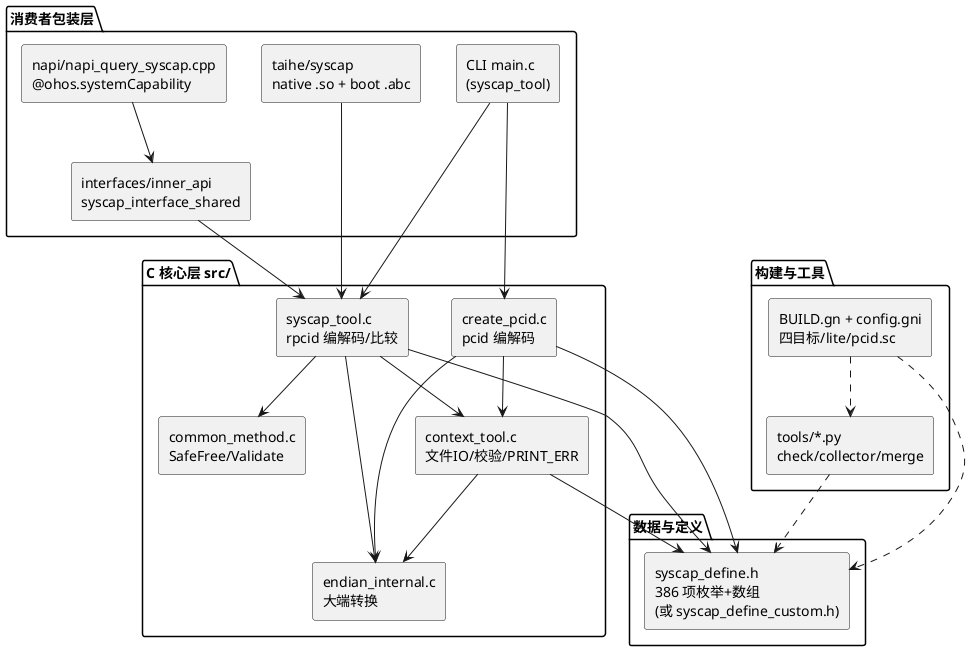

# 架构设计及约束

> 路径约定：源码路径均相对仓根 `developtools/syscap_codec`。本仓无法脱离 OHOS 源码树独立编译（GN 构建，`import("//build/ohos.gni")` 等）。

## 架构设计

### 设计原则

| 原则 | 描述 | 理由 |
|---|---|---|
| 单一 C 核心多包装 | 全部编解码逻辑收敛在 `src/*.c` 五个文件，CLI/共享库/NAPI/Taihe 各自只做薄包装；同一套源文件重复编译进各目标（无内部静态库） | 保证 CLI、PC 工具与设备侧行为完全一致；AGENTS.md 明示"内部不存在静态库"，避免符号裁剪差异 |
| 紧凑确定性编码 | pcid 用 120 字节位图表达 OS SysCap + 尾串表达 private SysCap；rpcid 用 256 字节定长记录；多字节字段统一大端 | `.sc` 体积小且跨平台字节级一致；位图支撑高效集合运算（比较即异或+掩码） |
| 权威清单单源 | `include/codec_config/syscap_define.h` 枚举与 `g_arraySyscap` 数组 1:1（各 386 项），追加式维护 | SysCap 编号是跨仓契约（bundle.json、d.ts、镜像位图都引用），删除/重排即全链路断裂 |
| ABI 契约显式化 | `libsyscap_interface_shared.versionscript` 白名单导出 7 个符号，`local: *` 隐藏其余 | 下游部件动态链接依赖导出面；新增导出须同步脚本 |
| 安全家底 | 共享库/NAPI/Taihe 目标开启 `cfi`+`cfi_cross_dso` sanitize 与 `branch_protector_ret = "pac_ret"`；C 代码全量使用 securec（memcpy_s/strcpy_s/sprintf_s/strcat_s 等）；输入长度先验（`ValidateRpcidInput`、文件大小上限） | 处理不可信输入（json/二进制/字符串），须防越界与溢出 |
| 厂商扩展隔离 | 外部 SysCap 通过构建参数 `syscap_codec_config_extern_path` 注入，构建期 merge 出 `syscap_define_custom.h`（编号 ≥ 500），不改仓内主清单 | 主清单保持社区纯净；扩展编号从 500 起与社区段隔离（`tools/syscap_config_merge.py` 头注释） |

### 逻辑架构

三层结构（依据实际源码组织）：

**1. C 核心层（`src/`，被全部 4 个目标重复编译）**
- `syscap_tool.c`：rpcid 编码/解码/字符串化、比较入口（`ComparePcidWithRpcidString`）、字符串解析（`SeparateSyscapFromString`/`GetPriSyscapData`/`CopyInputString`）
- `create_pcid.c`：pcid 编码/解码/字符串化（`CreatePCID`/`DecodePCID`/`EncodePcidscToString`/`DecodeStringPCIDToJson`）与位图填充（`SetOsSyscap`/`SetPriSyscap`/`SetPCIDHeader`）
- `context_tool.c`：文件 I/O（`GetFileContext`/`ConvertedContextSaveAsFile`）、rpcid 格式校验（`CheckRpcidFormat`）、全量 SysCap JSON 对象构建（`CreateWholeSyscapJsonObj`）、`PRINT_ERR` 宏与 `RPCIDHead` 定义（`include/context_tool.h`）
- `endian_internal.c`：运行时大小端检测与 16/32 位转换（`CheckEndian`/`HtonsInter`/`NtohsInter`/`HtonlInter`/`NtohlInter`）
- `common_method.c`：`SafeFree`、`ValidateRpcidInput`（输入长度先验）
- 数据源：`include/codec_config/syscap_define.h`（`SyscapWithNum{str[273], num}` 数组 + `SystemCapabilityNum` 枚举；`SYSCAP_DEFINE_EXTERN_ENABLE` 宏存在时改 include 生成的 `syscap_define_custom.h`）

**2. 消费者包装层**
- CLI：`src/main.c`（getopt_long 解析 → `SetBitMap` 组合状态 → `OperateByBitMap` 按魔数分发）
- 共享库：`interfaces/inner_api/syscap_interface.{h,c}`（设备侧 API：`EncodeOsSyscap`/`EncodePrivateSyscap` 读 `/system/etc/pcid.sc`；`DecodeOsSyscap`/`DecodePrivateSyscap`；`DecodeRpcidToStringFormat`；`ComparePcidString`/`FreeCompareError` 输出结构化比较结果）
- NAPI：`napi/napi_query_syscap.cpp`（C++ 桥接，async work 异步查询，promise/回调双形态）+ `napi/query_syscap.js`（`requireInternal('systemCapability')` 转发）
- Taihe：`taihe/syscap/idl/ohos.systemCapability.taihe`（IDL 源）→ `ohos_taihe` 生成 `ohos.systemCapability.ani.cpp`/`ohos.systemCapability.abi.c`/`@ohos.systemCapability.ets`（编译为 boot abc）；手写 `taihe/syscap/src/ohos.systemCapability.impl.cpp`（实现 `querySystemCapabilitie`）与 `ani_constructor.cpp`（ANI 运行时注册）

**3. 构建与工具层**
- `BUILD.gn`：四目标定义 + lite 分支（`ohos_lite` 下 liteos_m 为空 group、liteos_a 用原生 `shared_library`）+ `build_ext_component("generate_pcid")`（构建期用 host clang 编译的 syscap_tool 把 preloader 的 SystemCapability.json 编码为 pcid.sc）+ `ohos_prebuilt_etc("pcid.sc")` 装镜像
- `config.gni`：`syscap_codec_config_path`（头文件目录定制）、`syscap_codec_config_extern_path`（外部扩展，非空时触发 `action("gen_syscap_define_custom")` 跑 `tools/syscap_config_merge.py`，产出 `${root_build_dir}/syscap_define_custom.h` 并定义 `-DSYSCAP_DEFINE_EXTERN_ENABLE`）
- `tools/`：`syscap_check.py`（三方一致性检查）、`syscap_collector.py`（产品 SysCap 收集）、`syscap_config_merge.py`（构建期清单合并）
- `test/unittest/common/`：gtest 用例（标准系统 `ohos_unittest("syscap_codec_test")`；lite `executable("test_syscap_napi_unittest")`，仅 liteos_a）

### 非功能设计

| 场景类别 | 方案设计 |
|---|---|
| 跨平台一致性 | 多字节字段统一大端（网络序）；`endian_internal.c` 的 `CheckEndian()` 用 union 探测本机字节序后决定是否换字节（`B_L_SWAP16/32`），Linux/Windows(MinGW)/macOS 三平台产物字节级一致 |
| 内存安全 | 全量 securec 系列函数替代裸 memcpy/strcpy/sprintf；`GetFileContext` 做路径长度（PATH_MAX）、读权限（S_IRUSR）、文件大小（>0 且 < UINT32_MAX-1）三重校验；`ValidateRpcidInput` 先验 buffer 长度再读 sysCapLength；`EncodePcidscToString` 限制 pcid.sc ≤ 1128 字节；`SetOsSysCap`/`SetOsSysCapBitMap` 校验位图 sector < 120 |
| 编译加固 | 共享库/NAPI/Taihe 目标：`sanitize = { cfi = true, cfi_cross_dso = true, debug = false }`、`branch_protector_ret = "pac_ret"` |
| 错误处理 | `PRINT_ERR` 宏带 `__FILE__:__LINE__` 前缀输出到 stdout；分层 free 宏（`FREE_*_AFTER_*` 系列）逐级释放已分配资源，避免泄漏；共享库返回 bool/int32 语义化错误码（E_ERROR/E_OK/E_APIVERSION/E_SYSCAP 可按位组合） |
| 资源释放 | `CompareError` 结果由调用方用 `FreeCompareError` 释放；`DecodeOsSyscap`/`DecodePrivateSyscap` 输出数组由调用方 free |
| 异步友好 | NAPI 用 `napi_create_async_work` + promise/回调双形态；Taihe 由 IDL 的 `@gen_async`/`@gen_promise` 注解生成异步签名 |
| 可定制性 | `syscap_codec_config_path` 可整体替换头文件目录；`syscap_codec_config_extern_path` 增量合并外部清单（编号 ≥ 500） |

## 架构约束

- **src/*.c 修改影响全部 4 个目标**
  - **what**：`sources_platform_common`（`BUILD.gn:27-33`）把 `syscap_tool.c/create_pcid.c/endian_internal.c/context_tool.c/common_method.c` 编入 CLI、共享库（含 lite 变体）、NAPI、Taihe 全部目标；`syscap_interface.c` 编入共享库/NAPI/Taihe 三个目标。
  - **why**：任一目标行为漂移（如 CLI 与设备侧解码结果不一致）将造成 IDE 判定与应用市场/运行时判定不一致。

- **SysCap 编号只增不减不重排**
  - **what**：`syscap_define.h` 的 `SystemCapabilityNum` 枚举与 `g_arraySyscap` 必须末尾追加、1:1 对应、按枚举值升序；废弃仅注释 `// abandoned`。
  - **why**：编号即 pcid 位图中的 bit 位、bundle.json/d.ts 的引用键；删除或重排使旧 pcid.sc 解析错位、跨版本比较失真。

- **ABI 契约冻结**
  - **what**：`libsyscap_interface_shared.versionscript` 的 7 个符号（ComparePcidString/DecodeOsSyscap/DecodePrivateSyscap/EncodeOsSyscap/EncodePrivateSyscap/DecodeRpcidToStringFormat/FreeCompareError）与 `syscap_interface.h` 已有函数签名不可变更，只可新增。
  - **why**：下游部件动态链接；改签名=运行时符号缺失。

- **编码格式为跨版本兼容契约**
  - **what**：`PCIDMain` 位域布局（15+1+3+13 bit 头 + manufacturerID + osSyscap[120]）、rpcid 定长记录（SINGLE_FEAT_LEN=256、sysCaptype=2、apiVersionType=1/0 区分）、大端序不可变更。
  - **why**：`.sc` 文件在 IDE、应用市场、设备之间跨工具版本流转；格式漂移即互不识别。

- **外部扩展编号 ≥ 500**
  - **what**：`syscap_config_merge.py` 要求扩展枚举首项标记值 ≥ 500（与社区段隔离）。
  - **why**：避免厂商扩展与社区主清单编号冲突。

- **Taihe 生成物不可手改**
  - **what**：`ohos.systemCapability.ani.cpp`/`ohos.systemCapability.abi.c`/`@ohos.systemCapability.ets` 由 `ohos_taihe` 从 `.taihe` IDL 生成（位于 `$taihe_file_path/out/developtools/syscap_codec/`，不入版本管理）；手写侧只改 `src/*.impl.cpp`、`ani_constructor.cpp` 与 IDL 源。
  - **why**：生成文件下次构建被覆盖；API 形状（异步/签名）由 IDL 注解决定。

- **Taihe/NAPI 目标的构建条件**
  - **what**：NAPI 目标仅在 `support_jsapi && is_standard_system` 时进入 `syscap_codec` group（`BUILD.gn:205-207`）；Taihe group 仅 `support_jsapi`（`taihe/BUILD.gn:17`）；liteos_m 上共享库目标退化为空 group。
  - **why**：小型/轻量系统无 JS 运行时或无动态库支持。

- **macOS 产物须在 macOS 宿主构建**
  - **what**：README_ZH.md 明确 ubuntu 只能编 windows/linux 版本，mac 版需 macos 开发机。
  - **why**：工具链与 MinGW/POSIX 宏（`is_mingw` → `_POSIX_`，`context_tool.c` 据此跳过 realpath）平台差异。
