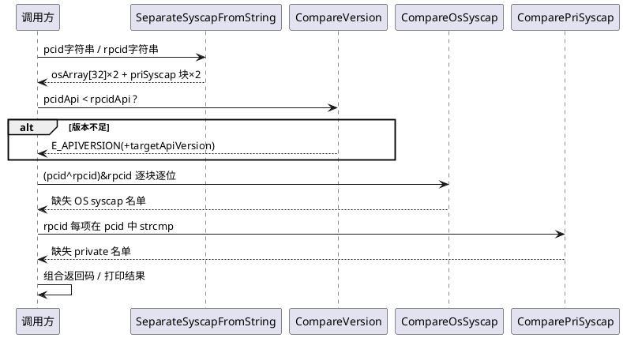

# 技术术语知识

syscap_codec 仓核心技术框架和机制的知识定义，涵盖价值认知、原理、使用方式和代码关联。> 源码路径均相对仓根 `developtools/syscap_codec`。

## PCID 位图编码机制

### 解决的问题（Problem）
| 子维度 | 内容 |
|---|---|
| 业务痛点 | 设备能力集合（数百项）需要紧凑、可快速做集合运算的表达，且要嵌入镜像与设备存储 |
| 技术目标 | 用 120 字节位图表达 ≤ 960 个 OS SysCap，支持常量时间置位/查询与一次异或完成集合差 |

### 原理（Principles）
| 子维度 | 内容 |
|---|---|
| 核心机制 | `PCIDMain`（`include/create_pcid.h:23-30`）固定 128 字节：位域头（apiVersion:15 + apiVersionType:1 恒 0 + systemType:3 + reserved:13）+ manufacturerID(u32) + osSyscap[120]。编码：`SetPCIDHeader`（:131）填头（systemType 字符串→位编码 mini=0b001/small=0b010/standard=0b100，`HtonsInter`/`HtonlInter` 转大端）；`SetOsSyscap`（:70）对每个 OS syscap 查 `CreateWholeSyscapJsonObj()` 的编号，`sector = num/8, pos = num%8`，`osSyscap[sector] |= 1 << pos`，sector ≥ 120 即报"out of 960"拒绝；`SetPriSyscap`（:104）把 private 项去前缀后 `strcat_s` 追加逗号串到结构体尾部 |
| 关键流程 | `CreatePCID()`（:247）：读 json（api_version/system_type/manufacturer_id/syscap.os/syscap.private）→ `GetOsAndPriSyscapSize` + `GetPriSyscapLen`（private 总长 ≤ `PRIVATE_SYSCAP_SIZE=1000`）→ malloc(sizeof(PCIDMain)+priLen+1) → 三段填充 → `ConvertedContextSaveAsFile` 落盘 pcid.sc。解码 `DecodePCID()`（:478）反向：校验 apiVersionType==0 与 systemType 合法 → `GetOsSyscap`（:306）扫位图置位得到编号序列，回表得全称 → `GetPriSyscap`（:361）逐字符切逗号串补前缀 → 组 json 落盘 pcid.json |

### 使用方式（Usage）
| 子维度 | 内容 |
|---|---|
| 核心 API | CLI：`syscap_tool -Pei pcid.json -o path/`（编码）、`-Pdi pcid.sc`（解码）、`-Pesi`/`-Pdsi`（字符串互转）。构建系统：`generate_pcid` action 自动对 SystemCapability.json 执行 `-P -e`。无进程内 API（进程内走共享库 EncodeOsSyscap 族） |

### 代码关联（Code）
| 子维度 | 内容 |
|---|---|
| 核心类 | `PCIDMain`/`PCIDHeader`（`include/create_pcid.h`） |
| 核心成员 | `osSyscap[OS_SYSCAP_BYTES=120]` 位图；private 尾串（结构体后偏移） |
| 核心方法 | `CreatePCID`/`DecodePCID`/`SetPCIDHeader`/`SetOsSyscap`/`SetPriSyscap`/`GetOsSyscap`/`GetPriSyscap`（`src/create_pcid.c`） |

### 约束与限制（Constraints）
| 子维度 | 内容 |
|---|---|
| 系统限制 | OS SysCap ≤ 960；private 尾串 ≤ 1000 字节；`EncodePcidscToString` 限制 pcid.sc ≤ 1128 字节 |
| 并发约束 | 纯函数式，无共享状态 |
| 安全约束 | 输入 json 经 `CheckFileAndGetFileContext`（路径/权限/大小）校验；`strcat_s`/`strcpy_s` 防溢出；位图 sector 越界显式拒绝 |

## RPCID 定长记录编码机制

### 解决的问题（Problem）
| 子维度 | 内容 |
|---|---|
| 业务痛点 | 应用需求侧的 syscap 列表由 IDE 从应用配置生成，可能含主清单外的新能力，不能用位图（编号未知） |
| 技术目标 | 用"头 + 类型/长度 + 定长记录"的可扩展布局，无需编号即可承载任意 syscap 字符串 |

### 原理（Principles）
| 子维度 | 内容 |
|---|---|
| 核心机制 | 布局：`RPCIDHead{apiVersion:15, apiVersionType:1 恒 1}`（2 字节）+ u16 `sysCaptype`（恒 2 = app syscap）+ u16 `sysCapLength`（记录区字节数）+ N × `SINGLE_FEAT_LEN=256` 字节定长块（去 `SystemCapability.` 前缀，`\0` 补齐）。编码 `FillOsCapLength`（`src/syscap_tool.c:83`）：取 json `api_version` 写头、逐项校验前缀（strchr 找 `.` + strncmp）、`memcpy_s` 拷 `pointPos+1` 起 256 字节槽 |
| 关键流程 | `RPCIDEncode()`（:145）计算 buffer = sizeof(RPCIDHead) + 2×u16 + N×256 → 填充 → 落盘 rpcid.sc。解码：`CheckRpcidFormat`（`src/context_tool.c:177`）三重校验（长度 ≥ 8、apiVersionType==1、sysCaptype==2、总长自洽）→ `ParseRpcidToJson`（`src/syscap_tool.c:202`）按 `sysCapCount = sysCapLength/256` 逐块取串（长度须 < 256 且非 0）补前缀组 json |

### 使用方式（Usage）
| 子维度 | 内容 |
|---|---|
| 核心 API | CLI：`-Rei rpcid.json`（编码）、`-Rdi rpcid.sc`（解码）、`-Resi rpcid.sc`（转字符串）。共享库：`DecodeRpcidToStringFormat(inputFile)` 返回字符串（内部含 outBuffer 生命周期说明见 Constraints） |

### 代码关联（Code）
| 子维度 | 内容 |
|---|---|
| 核心类 | `RPCIDHead`（`include/context_tool.h:36-39`） |
| 核心成员 | sysCaptype/sysCapLength 两 u16 头字段；256 字节定长记录区 |
| 核心方法 | `RPCIDEncode`/`FillOsCapLength`/`RPCIDDecode`/`ParseRpcidToJson`/`EncodeRpcidscToString`（`src/syscap_tool.c`）；`CheckRpcidFormat`（`src/context_tool.c:177`）；`ValidateRpcidInput`（`src/common_method.c:28`） |

### 约束与限制（Constraints）
| 子维度 | 内容 |
|---|---|
| 系统限制 | 每条记录定长 256 字节（去前缀后实际串长 < 256）；`-Rdsi`（字符串→json）CLI 显式不支持（`OperateByBitMap` 0x10E 分支打印提示） |
| 并发约束 | 纯函数式 |
| 安全约束 | `ValidateRpcidInput` 先验 buffer ≥ 8 字节且 ≥ 头+记录区长度才读取；记录长度 == 0 或 ≥ 256 拒绝 |

## 跨平台大端序列化（endian_internal）

### 解决的问题（Problem）
| 子维度 | 内容 |
|---|---|
| 业务痛点 | `.sc` 产物在 x86_64 Linux/Windows（小端）与潜在大端环境间流转，且编码端（PC）与解码端（设备）架构可能不同 |
| 技术目标 | 所有多字节字段统一网络序（大端），任意平台产物字节级一致 |

### 原理（Principles）
| 子维度 | 内容 |
|---|---|
| 核心机制 | `CheckEndian()`（`src/endian_internal.c:25`）用 union `{int32_t i; uint8_t s[4]}` 置 `0x12345678` 探测本机序（`c.s[0]==0x12` 即大端）；`HtonsInter/HtonlInter`（主机→网络）与 `NtohsInter/NtohlInter`（网络→主机）按探测结果直通或 `B_L_SWAP16/B_L_SWAP32` 字节交换 |
| 关键流程 | 编码侧写头（`SetPCIDHeader`/`FillOsCapLength`）用 Htons/Htonl；解码侧读头（`GetOsSyscap`/`CompareVersion`/`ParseRpcidToJson`）用 Ntohs/Ntohl；位图与字符串区为单字节无转换 |

### 使用方式（Usage）
| 子维度 | 内容 |
|---|---|
| 核心 API | `HtonsInter(uint16_t)`/`NtohsInter(uint16_t)`/`HtonlInter(uint32_t)`/`NtohlInter(uint32_t)`（`src/endian_internal.h` 声明，extern "C" 兼容 C++） |

### 代码关联（Code）
| 子维度 | 内容 |
|---|---|
| 核心类 | 无类，纯函数 |
| 核心成员 | `B_L_SWAP16/B_L_SWAP32` 宏（`src/endian_internal.c:19-21`） |
| 核心方法 | `CheckEndian`（:25）、四个转换函数（:36-53） |

### 约束与限制（Constraints）
| 子维度 | 内容 |
|---|---|
| 系统限制 | 每次转换重复探测字节序（无缓存），性能可忽略（调用次数有限）；16/32 位以外（u64）未提供 |
| 并发约束 | 无状态线程安全 |
| 安全约束 | 不涉及（纯数值变换）；但**禁止**绕过此封装直接写多字节字段（见 [coding-standards.md](coding-standards.md)） |

## 位图驱动 CLI 分发（SetBitMap / OperateByBitMap）

### 解决的问题（Problem）
| 子维度 | 内容 |
|---|---|
| 业务痛点 | CLI 是多选项组合语义（-R/-P 选对象、-e/-d 选方向、-s 选形态、-i/-o/-C 传参），if-else 嵌套不可维护 |
| 技术目标 | 把"选项组合"收敛为单个 16 位状态字，一次 switch 分发 |

### 原理（Principles）
| 子维度 | 内容 |
|---|---|
| 核心机制 | `SetBitMap()`（`src/main.c:146`）为每个选项置专属位：ENCODE(0)/DECODE(1)/STRING_DECODE(2)/RPCID(3)/PCID(4)/PCID_STRING(5)/RPCID_STRING(6)/VERSION(7)/INPUT_FILE(8)/OUTPUT_FILE(9)/HELP(10)；`-C` 同时置 PCID_STRING|RPCID_STRING 两位并记录两文件；`-o` 直接改 outputpath 不进位图 |
| 关键流程 | `main()` getopt_long 循环（`-C` 额外校验 argc==4）→ `OperateByBitMap()`（:106）按组合魔数精确匹配 case：0x109→RPCIDEncode、0x10A→RPCIDDecode、0x10D→EncodeRpcidscToString、0x115→EncodePcidscToString、0x111→CreatePCID、0x112→DecodePCID、0x116→DecodeStringPCIDToJson、0x60→ComparePcidWithRpcidString(TYPE_FILE)、0x64→同函数(TYPE_STRING)、0x80→版本输出、0x10E→显式不支持提示、default→帮助 |

### 使用方式（Usage）
| 子维度 | 内容 |
|---|---|
| 核心 API | CLI 命令形态见 `PrintHelp()`（`src/main.c:197`）：`syscap_tool -R/P -e/d -i filepath [-o outpath]`；`-v` 输出 `syscap_tool v2.0.1` |

### 代码关联（Code）
| 子维度 | 内容 |
|---|---|
| 核心类 | 无；`g_longOptions`（:51）getopt 长选项表、`g_customerfileinfo`（:65）输入文件三槽 |
| 核心成员 | `bitMap`（uint16_t 状态字） |
| 核心方法 | `main`（:71）、`SetBitMap`（:146）、`OperateByBitMap`（:106）、`PrintHelp`/`PrintVersion` |

### 约束与限制（Constraints）
| 子维度 | 内容 |
|---|---|
| 系统限制 | 新增命令组合须同步：SetBitMap 选项位 + OperateByBitMap case + PrintHelp 文本（AGENTS.md「常见任务路径」） |
| 并发约束 | 单进程 |
| 安全约束 | `-C` 输入文件数硬校验（argc != 4 拒绝）；输入路径经 `GetFileContext` PATH_MAX/realpath 校验（`_POSIX_`/MinGW 分支用 strncpy_s 替代 realpath） |

## PCID/RPCID 比较判定机制

### 解决的问题（Problem）
| 子维度 | 内容 |
|---|---|
| 业务痛点 | 应用市场/包管理器需要回答"这台设备（pcid）能否安装这个应用（rpcid）"，且要给出不满足的具体原因 |
| 技术目标 | 三维判定（API 版本、OS 能力、私有能力）+ 结构化缺失清单 |

### 原理（Principles）
| 子维度 | 内容 |
|---|---|
| 核心机制 | 字符串入口：`SeparateSyscapFromString`（`src/syscap_tool.c:594`）把"32×u32+private 列表"解析为 `osArray[32]`（复用为 PCIDMain/RPCIDHead 视图）与 priSyscap 定长块数组。版本维：`CompareVersion`（:692）pcidApiVersion < rpcidApiVersion 即不足。OS 维：`CompareOsSyscap`（:637）对 i∈[2,32) 的每个 u32 块计算 `(pcid^rpcid) & rpcid`（rpcid 要求而 pcid 缺失的 bit），逐 bit 反查 `g_arraySyscap` 得缺失名。Private 维：`ComparePriSyscap`（:668）rpcid 每项在 pcid 定长块中 strcmp 查找 |
| 关键流程 | CLI：`ComparePcidWithRpcidString`（:718）TYPE_FILE/TYPE_STRING 双入口 → 三维比较 → 成功打印 `Succeed!...`，失败逐行 `Missing: <syscap>` + 总结。共享库：`ComparePcidString`（`interfaces/inner_api/syscap_interface.c:655`）同构三维（`ComparePcidWithOsSyscap`/`ComparePcidWithPriSyscap`），结果填 `CompareError`（缺失串逐个 malloc，`MAX_MISS_SYSCAP=512` 上限防越界），返回码按位组合 E_APIVERSION/E_SYSCAP |

### 使用方式（Usage）
| 子维度 | 内容 |
|---|---|
| 核心 API | CLI：`syscap_tool -C pcid.txt rpcid.txt` / `-sC "pcidstr" "rpcidstr"`。共享库：`ComparePcidString(pcidString, rpcidString, CompareError*)` → 返回 E_OK/E_APIVERSION/E_SYSCAP 组合 → 用后 `FreeCompareError` |

### 代码关联（Code）
| 子维度 | 内容 |
|---|---|
| 核心类 | `CompareError`（`interfaces/inner_api/syscap_interface.h:40-44`） |
| 核心成员 | `syscap[MAX_MISS_SYSCAP=512]` 缺失串指针数组、`missSyscapNum`、`targetApiVersion` |
| 核心方法 | CLI 侧 `ComparePcidWithRpcidString`/`CompareOsSyscap`/`ComparePriSyscap`/`CompareVersion`/`SeparateSyscapFromString`（`src/syscap_tool.c`）；库侧 `ComparePcidString`/`ComparePcidWithOsSyscap`/`CheckPcidEachBit`/`CopySyscopToRet`（`syscap_interface.c`） |

### 约束与限制（Constraints）
| 子维度 | 内容 |
|---|---|
| 系统限制 | 只支持字符串格式入口（二进制 `.sc` 须先 `-es` 转字符串）；CLI 的 `-Rdsi` 反向不支持导致 rpcid 字符串→json 需走共享库或其他路径 |
| 并发约束 | 纯函数；`strtok_r` 在 `CopyInputString` 的私有拷贝上进行（不破坏调用方串） |
| 安全约束 | 输入串 ≤ 1024（`STRING_FORMAT_LEN_MAX`）；库侧缺失数达 512 即中止并释放（防越界）；位图反查 `GetSyscapByIndex` 负值跳过 |

## SysCap 清单追加式维护与外部扩展合并

### 解决的问题（Problem）
| 子维度 | 内容 |
|---|---|
| 业务痛点 | 社区主清单演进（只增）与厂商私有扩展（不可入社区）需要共存，且扩展不能与社区编号冲突 |
| 技术目标 | 主清单保持追加式；厂商扩展经构建参数注入，合并产物对编译单元透明 |

### 原理（Principles）
| 子维度 | 内容 |
|---|---|
| 核心机制 | 主清单规则：`SystemCapabilityNum` 枚举与 `g_arraySyscap` 末尾追加、1:1、废弃仅 `// abandoned`（当前 386/386）。扩展：`config.gni` 的 `syscap_codec_config_extern_path` 非空时，GN `action("gen_syscap_define_custom")`（`BUILD.gn:178-193`）以 `--base`(仓内头) `--extern`(外部头) `--output`(`${root_build_dir}/syscap_define_custom.h`) 调 `tools/syscap_config_merge.py`；后者 `read_syscap` 解析两份头的枚举与数组段，`merge_define` 拼接（若 base 尾项与 extern 首项都带 500 标记则去重衔接），重排版为完整头文件。同时目标获得 `-DSYSCAP_DEFINE_EXTERN_ENABLE` 宏 + `${root_build_dir}` include，`src/*.c` 顶部的条件 include 改用 custom 头 |
| 关键流程 | extern 头要求：扩展枚举首项显式标记值 ≥ 500（`syscap_config_merge.py` 头注释）；四个目标（CLI/共享库 lite 与标准/NAPI/Taihe）都把 `gen_syscap_define_custom` 挂入 deps 并把 custom 头列入 inputs，保证合并先于编译 |

### 使用方式（Usage）
| 子维度 | 内容 |
|---|---|
| 核心 API | 构建参数：`syscap_codec_config_path`（整体替换头文件目录，默认 `//developtools/syscap_codec/include/codec_config`）、`syscap_codec_config_extern_path`（外部头路径）。维护者检查：`python3 tools/syscap_check.py -p <ohos_root> -t component_codec` |

### 代码关联（Code）
| 子维度 | 内容 |
|---|---|
| 核心类 | `SyscapWithNum`（`include/codec_config/syscap_define.h:29-32`） |
| 核心成员 | `g_arraySyscap[]`（386 项 const static）、`SystemCapabilityNum` 枚举 |
| 核心方法 | `read_syscap`/`merge_define`/`assemble_header_file`（`tools/syscap_config_merge.py:87/116/129`） |

### 约束与限制（Constraints）
| 子维度 | 内容 |
|---|---|
| 系统限制 | 扩展编号 ≥ 500；`syscap_define_custom.h` 是生成物禁止手改/提交；`SINGLE_SYSCAP_LEN` 在 custom 头中必须与主清单一致（merge 模板固定 256+17） |
| 并发约束 | GN action 单次执行，输出原子替换 |
| 安全约束 | merge 脚本以 0o640 权限创建输出文件（`os.open` mode 参数） |

## 多目标源码共享构建（一源多壳）

### 解决的问题（Problem）
| 子维度 | 内容 |
|---|---|
| 业务痛点 | CLI（PC 三平台）、共享库（lite/标准两种构建体系）、NAPI、Taihe 四类产物需要完全一致的编解码行为 |
| 技术目标 | 单一 C 核心源集重复编入各目标，行为差异只允许来自包装层 |

### 原理（Principles）
| 子维度 | 内容 |
|---|---|
| 核心机制 | `sources_platform_common`（`BUILD.gn:27-33`：syscap_tool.c/create_pcid.c/endian_internal.c/context_tool.c/common_method.c）被四目标引用：CLI（:35 加 main.c）、共享库标准（:114 加 syscap_interface.c）、NAPI（`napi/BUILD.gn:26-32` 加 syscap_interface.c + napi_query_syscap.cpp + JS 对象）、Taihe（`taihe/syscap/BUILD.gn:51-60` 加 syscap_interface.c + 生成物 + impl/constructor）。lite：liteos_m 共享库空 group、liteos_a 原生 shared_library（:78）；CLI 在 liteos_m 加 `PATH_MAX=1024`/`-Wno-int-conversion`，is_mingw 加 `_POSIX_`（:47-53）；cJSON 依赖 lite 走 `//build/lite/config/component/cJSON`、标准走 `cJSON:cjson_static` external_deps |
| 关键流程 | 差异化配置经 `config("internal")`（:18-25）下发：include `syscap_codec_config_path`、extern 启用时加 `-DSYSCAP_DEFINE_EXTERN_ENABLE` 与 `${root_build_dir}`。目标条件：NAPI 仅 `support_jsapi && is_standard_system` 进 `syscap_codec` group（:205），Taihe group 仅 `support_jsapi`（`taihe/BUILD.gn:17`）；`syscap_tool_bin_linux`（:147）用 host clang 工具链为 generate_pcid 提供 PC 侧可执行 |

### 使用方式（Usage）
| 子维度 | 内容 |
|---|---|
| 核心 API | ninja 目标：`developtools/syscap_codec:syscap_tool_bin`、`:syscap_interface_shared`、`napi:systemcapability`、`taihe:taihe_group`；产物入口 `group("syscap_codec")` = pcid_sc + syscap_interface_shared（+NAPI 条件） |

### 代码关联（Code）
| 子维度 | 内容 |
|---|---|
| 核心类 | 无（构建机制） |
| 核心成员 | `sources_platform_common`、`config("internal")`、`config("syscap_interface_public_config")` |
| 核心方法 | 无；相关 target 定义见 `BUILD.gn`、`napi/BUILD.gn`、`taihe/syscap/BUILD.gn`、`test/unittest/common/BUILD.gn` |

### 约束与限制（Constraints）
| 子维度 | 内容 |
|---|---|
| 系统限制 | 无法脱离 OHOS 源码树编译；macOS 产物须 macOS 宿主；liteos_m 无共享库产物 |
| 并发约束 | GN/ninja 调度，无共享写冲突 |
| 安全约束 | 共享库/NAPI/Taihe 三目标均开 cfi(+cross_dso) 与 pac_ret；新增目标须对齐 |

## 构建期 pcid.sc 生成链（generate_pcid）

### 解决的问题（Problem）
| 子维度 | 内容 |
|---|---|
| 业务痛点 | 设备上的能力查询（NAPI/Taihe/共享库）依赖 `/system/etc/pcid.sc` 存在，不能靠人工放置 |
| 技术目标 | 构建系统自动把当前产品的 SysCap 集合编码为 pcid.sc 并装入镜像 |

### 原理（Principles）
| 子维度 | 内容 |
|---|---|
| 核心机制 | `build_ext_component("generate_pcid")`（`BUILD.gn:151-167`）：deps `syscap_tool_bin_linux`（host clang 编译的 syscap_tool，位于 `clang_${host_cpu}/developtools/syscap_codec/syscap_tool`；lite 直接在 `clang_${host_cpu}/` 下）；command = chmod + `syscap_tool -P -e -i ${preload_path}/system/etc/SystemCapability.json`，输出 `$root_out_dir/pcid.sc`；lite 额外 mkdir + cp 到 `$exec_path/system/etc/pcid.sc` |
| 关键流程 | preloader 产出产品 SystemCapability.json → generate_pcid 用 host 工具编码 → `ohos_prebuilt_etc("pcid.sc")`（:169-174）把 `$root_out_dir/pcid.sc` 作为源装入镜像（安装到 `/system/etc/pcid.sc`）→ group `pcid_sc`（:196）纳入部件入口 |

### 使用方式（Usage）
| 子维度 | 内容 |
|---|---|
| 核心 API | 无独立 API；随 `syscap_codec` group / 镜像构建自动执行。调试可单独跑 `ninja -C out/{board} developtools/syscap_codec:pcid_sc` |

### 代码关联（Code）
| 子维度 | 内容 |
|---|---|
| 核心类 | 无 |
| 核心成员 | `preload_path`（preloader 输出目录，rebase 引入）、`outputs = ["$root_out_dir/pcid.sc"]` |
| 核心方法 | 无（command 字段内联） |

### 约束与限制（Constraints）
| 子维度 | 内容 |
|---|---|
| 系统限制 | 依赖 preloader 的 SystemCapability.json 先行生成（构建序：preloader → GN → 本 action）；pcid.sc 内容随产品配置变化，无缓存语义 |
| 并发约束 | 单 action；host 工具构建为其显式 deps |
| 安全约束 | chmod 777 + 直接执行；输入为构建系统内部产物（非不可信输入面） |

## 设备侧异步查询桥接（NAPI / Taihe）

### 解决的问题（Problem）
| 子维度 | 内容 |
|---|---|
| 业务痛点 | JS/ArkTS 应用需要在运行时获知设备能力串，而读取/解析 pcid.sc 是阻塞文件 IO + 内存操作，不能占 JS 主线程；且新旧两代 API 框架并存 |
| 技术目标 | 同一 C 核心之上提供 NAPI（`@ohos.systemCapability`）与 Taihe（IDL 驱动）双通道异步查询 |

### 原理（Principles）
| 子维度 | 内容 |
|---|---|
| 核心机制 | 共同内核 `GetSystemCapability()`：`EncodeOsSyscap(osOutput, 128)` 读 `/system/etc/pcid.sc` 头 → 按 `PCID_MAIN_U32=32` 个 u32 `sprintf_s` 为十进制串 → `EncodePrivateSyscap`+`DecodePrivateSyscap` 得全称 private 列表 → `CalculateAllStringLength` 逗号拼接（osCapArray[32][11] + priCapArray[N][273]）。NAPI（`napi/napi_query_syscap.cpp`）：`PreHandleSystemCapability` 识别回调参数（argc ≤ 1，函数类型建 ref，否则建 promise）→ `napi_create_async_work` 把 `GetSystemCapability` 放工作线程 → 完成回调 resolve/reject（失败消息 "key does not exist"）→ 清理 ref/work/context。模块经 constructor `SystemCapabilityRegisterModule` 注册（模块名 `systemCapability`），JS 桥 `napi/query_syscap.js` 用 `requireInternal('systemCapability')` 转发 `querySystemCapabilities`。Taihe（`taihe/syscap/`）：IDL `ohos.systemCapability.taihe` 声明 `@gen_async @gen_promise querySystemCapabilitie(): String` + `@!sts_inject` 注入 `loadLibraryWithPermissionCheck("systemCapability_taihe_native.z", ...)` → `ohos_taihe` 生成 ani/abi/ets → `generate_static_abc("systemCapability")` 编为 **boot abc** 装 `/system/framework/systemCapability.abc`；手写 `ohos.systemCapability.impl.cpp` 的 `querySystemCapabilitie()` 调同名 `GetSystemCapability`（与 NAPI 侧逐行同构），失败 `taihe::set_business_error(-1, "key does not exist")`，成功返回 string；`ani_constructor.cpp` 的 `ANI_Constructor` 调 `ohos::systemCapability::ANIRegister` 完成 ANI 运行时注册；导出符号由 `libsystemCapability_taihe_native.versionscript` 控制 |
| 关键流程 | 目标条件：NAPI 进 group 需 `support_jsapi && is_standard_system`；Taihe group 需 `support_jsapi`。生成物路径 `$taihe_file_path/out/developtools/syscap_codec/`，不入版本管理 |

### 使用方式（Usage）
| 子维度 | 内容 |
|---|---|
| 核心 API | JS：`import systemCapability from '@ohos.systemCapability'` 后 `systemCapability.querySystemCapabilities(): Promise<string>`（或回调）。Taihe/ArkTS：IDL 暴露同名异步方法（签名由 `.taihe` 生成） |

### 代码关联（Code）
| 子维度 | 内容 |
|---|---|
| 核心类 | `SystemCapabilityAsyncContext`（NAPI）、`g_systemCapabilityModule`（模块注册结构） |
| 核心成员 | `PCID_MAIN_U32=32`、`OS_SYSCAP_U32_NUM=30`、`KEY_BUFFER_SIZE=32`（两份实现常量一致） |
| 核心方法 | `QuerySystemCapability`/`PreHandleSystemCapability`/`GetSystemCapability`/`CalculateAllStringLength`（`napi/napi_query_syscap.cpp:179/154/110/53`）；`querySystemCapabilitie`（`taihe/syscap/src/ohos.systemCapability.impl.cpp:144`）、`ANI_Constructor`（`ani_constructor.cpp:17`）、`TH_EXPORT_CPP_API_querySystemCapabilitie`（导出宏） |

### 约束与限制（Constraints）
| 子维度 | 内容 |
|---|---|
| 系统限制 | 依赖设备 `/system/etc/pcid.sc` 存在（generate_pcid 装入）；NAPI/Taihe 的 `GetSystemCapability` 是两份独立实现，改动必须双侧同步（行为漂移即新老 API 结果不一致） |
| 并发约束 | NAPI：重活在 async work 线程，完成回调在 JS 线程，context 随 work 销毁；Taihe：实现同步、签名异步 |
| 安全约束 | Taihe 加载经 `loadLibraryWithPermissionCheck`；两通道均开 cfi/pac_ret；返回串由设备文件内容决定，无注入面（十进制与既定格式拼接） |

## SysCap 一致性检查与产品收集（tools/*.py）

### 解决的问题（Problem）
| 子维度 | 内容 |
|---|---|
| 业务痛点 | SysCap 声明散落三处（部件 bundle.json、syscap_define.h、sdk d.ts `@syscap`），人工对齐不可行 |
| 技术目标 | 自动三方比对找差异；按产品聚合实际 SysCap 集合 |

### 原理（Principles）
| 子维度 | 内容 |
|---|---|
| 核心机制 | `syscap_check.py`（310 行，依赖 prettytable==3.3.0）：`collect_syscap_from_codec`（正则 `{"(.*)"}` 从 syscap_define.h 抽集合）、`collect_syscap_from_component`（`find {dir} -name bundle.json` + 按 key 层级 `("component","syscap")` 取值，`=false` 后缀剥离）、`collect_syscap_from_sdk`（正则 `\* *@syscap +SystemCapability\..*` 扫 d.ts）；`mutual_diff` 双向差集 → PrettyTable 报告（含"仅在某方"的值与来源文件）。三种检查目标：component_codec / component_sdk / sdk_codec。`syscap_collector.py`（544 行）：`get_parts_info`（源码树 build_configs）+ `get_product_define_dict`（产品部件组成）→ `traversal_path`→`handle_bundle_json_file` 逐产品收集 bundle.json syscap（`=false` 项按产品定义排除）→ `dict_to_json` 输出 `{product}.json`（`{"SysCaps": [...]}`，重复项告警去重） |
| 关键流程 | 均为独立 CLI 工具，不参与编译：`python3 tools/syscap_check.py -p <ohos_root> -t {component_codec|component_sdk|sdk_codec} [-b bundle...]`；`python3 tools/syscap_collector.py -p <ohos_root>` |

### 使用方式（Usage）
| 子维度 | 内容 |
|---|---|
| 核心 API | 见上；`syscap_check.py` 的 `-b` 仅对 component_codec 生效（其余组合显式报错） |

### 代码关联（Code）
| 子维度 | 内容 |
|---|---|
| 核心类 | `PrettyTable`（三方） |
| 核心成员 | 黑名单目录 `("out",)`；bundle key 层级 `("component", "syscap")` |
| 核心方法 | `collect_syscap_from_codec/component/sdk`、`mutual_diff`、`print_check_result`（`syscap_check.py:95/114/152/202/227`）；`handle_bundle_json_file`/`traversal_path`/`dict_to_json`/`main`（`syscap_collector.py:120/157/36/528`） |

### 约束与限制（Constraints）
| 子维度 | 内容 |
|---|---|
| 系统限制 | 需要完整 OHOS 源码树路径；component 检查依赖 `find` 命令；sdk 检查只扫 `interface/sdk-js/api` 单层目录（不递归子目录，`os.listdir` 实现） |
| 并发约束 | 串行脚本 |
| 安全约束 | 离线只读；`syscap_collector.py` 输出文件用 `os.open` 显式 mode 创建 |
